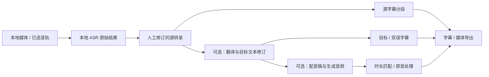

# GlyphCue V2 Product Scope

日期：2026-10-03\
状态：Discovery 研究建议稿；可作为 Claude Code Design 的讨论与设计输入，尚未获得最终范围批准。明确标为用户已定的内容具有约束力，其余建议与 Product Gates 不得默认为已批准的实现计划。

## 1. 产品方向与本次边界

**GlyphCue V2 是本地视频/音频的字幕与配音本地化工作台：以本地语音转录建立可编辑的时间文本，经过人工校正，可选择生成双语字幕、目标语言配音及最终媒体。**

用户已确定：

- V2 是产品重置，V1 保持冻结历史基线；烧录字幕 OCR 不再是核心输入。
- 核心输入是没有可用字幕的本地视频或音频，本地 ASR 为主要输入路线。
- 首批语言是英语、中文、法语，三者均可为源语言或目标语言，覆盖 `en→zh`、`zh→en`、`en→fr`、`fr→en`、`zh→fr`、`fr→zh` 六个方向。
- 主要使用场景是本地视频配音，以及语音转录后翻译成双语字幕。
- 本轮研究，不实施生产代码、不改 V1 历史记录；交付面向 Claude Code Design。

“语音转换后翻译双语字幕”在本稿按语音转文字再翻译理解，不自动扩展成保留原人声的 voice conversion。中文的普通话/方言、简繁体与英文/法文地域口音仍见 PG-02。

现有技术证据支持选择性重构；不支持直接将 Media Downloader 复制过来，也不支持先假定全量重写。[Media Downloader 调查](02_MEDIA_DOWNLOADER_ASR.md)、[V1 复用矩阵](05_V1_REUSE_REWORK_RETIRE.md)。

## 2. 首要用户任务

**双语字幕任务**：打开本地素材 → 确认音轨/语言/范围 → 本地转录 → 对照原音修改源文和时间 → 选择目标语言 → 带上下文翻译 → 校正译文、术语、双语断行 → 导出字幕，或在视频上烧录字幕。

**视频配音任务**：同一源文准备流程 → 形成并校正目标语言稿 → 选择许可清楚的合成声线 → 生成并试听配音 → 处理时长冲突和原音混合 → 导出配音音轨或配音视频，可同时带单语/双语字幕。

**不翻译的任务**仍完整可用：本地转录、校正、字幕和媒体导出不以启用云服务或配音为前提。已有可靠字幕可以导入以减少工作，但不让字幕下载、网站下载重新定义产品。

## 3. Core / Optional / Deferred

这里的 **Optional 是用户可跳过的处理阶段**，并非自动排除在 V2 产品方向之外。双语翻译和配音是用户的主要场景，必须参与首轮设计与可行性评估。V2.0 最终发行是否同时包含两者，是 PG-04 的明确产品决定，不能在实施时自行裁成“只做 ASR”。

| 类别 | 能力 | 成熟工作流要求 |
|---|---|---|
| Core C01 | 本地素材导入与预检 | 视频/音频可用音轨、时长、语言和范围可确认；无音轨、文件搬移、损坏、格式不支持有明确状态 |
| Core C02 | 本地 ASR | en/zh/fr 可显式选择，自动语言检测可覆盖；保留原始段/词结果与运行来源；可取消、有真实阶段进度；模型齐备后可离线工作 |
| Core C03 | 可编辑时间转录 | 复听定位、源文编辑、起止调整、拆分合并、搜索、撤销重做、保存再打开；重跑不会无提示覆盖人工编辑 |
| Core C04 | 字幕分段与复核 | 源转录与显示字幕有映射；可手改换行、标点与时间；长度/阅读速度、重叠、空段、疑似静音幻觉提示；不把每个 ASR segment 当最终字幕 |
| Core C05 | 项目与修订安全 | 源素材不被覆盖；原始 ASR、人工修订、目标文本和生成音频可追溯；失败后能保留已完成工作；依赖变化明确标记衍生内容需更新 |
| Core C06 | 模型与资源就绪 | 显示模型来源、版本、体积、许可、所需后端与设备；下载/离线导入有完整性校验；运行时不偷偷换模型或下载缺件 |
| Core C07 | 字幕及文本导出 | SRT/VTT/TXT；ASS 用于样式/烧录可作为内部或显式出口；启用翻译后支持源文、目标文、双语次序；可重复导出当前修订 |
| Core C08 | FFmpeg 媒体导出 | 单语/双语字幕烧录、适配容器的软字幕/音轨封装；清楚区分“嵌入可关闭字幕”与“永久烧入画面”；预览、取消、失败不留假成功产物 |
| Core C09 | 可解释状态与本地隐私 | 区分准备、下载、分析、生成、合成、失败；错误能定位到阶段；素材和文本只按所选处理位置流转，凭据不进入项目包 |
| Optional O01（首批重点） | LLM 字幕翻译 | 六方向；上下文/术语一致性、句段身份验证、缺漏/重复检查、人工逐段编辑和局部重译；保留源文，不让模型改时间轴 |
| Optional O02（首批重点） | AI 配音 | 三种目标语言；建议先标准合成声线和单旁白；目标口语稿可独立微调、逐段试听和局部重生，实际音频时长驱动放置/溢出处理；是否接受单旁白见 PG-04 |
| Optional O03 | 对齐增强 | 词级纠错/边界精修需要时才做 forced alignment；必须与同语言实际音频匹配；按语言选择并记录对齐模型 |
| Optional O04 | 手工说话人/声线分配 | 若配音场景确需多人物，可先支持人工标记与标准声线映射；自动多人识别不应成为首版通用依赖 |
| Optional O05 | 有效字幕导入与预览式清理 | 复用 V1 的 SRT/VTT 能力；去重/整理须预览差异，不能把真实重复讲话自动删掉 |
| Deferred | 声音克隆、同声色跨语言转换、唇形同步 | 非用户已要求的默认能力；权利、质量、时长与部署成本另立门槛 |
| Deferred | 自动多说话人分离与角色复刻、自动去原人声保留全部背景 | diarization 不等于分离音轨；音乐/混响/重叠人声使无损替换不可靠，不能把它当标准配音的隐含承诺 |
| Deferred | 实时会议/直播、网站下载、云协作、Anki/学习系统、AI 总结问答、视频编辑器 | 与当前两条主要任务无直接必要关系 |
| Retired from V2 core | OCR 模型、ROI 工作流、跨帧视觉共识 | 留在 V1 历史；不作为 V2 默认入口或依赖 |

## 4. 领域语义与数据流

术语见 [V2 词汇表](CONTEXT.md)。下图是设计约束建议，不是既有实现。

需要保留四个不同的时间事实：源媒体时间、ASR 的估计词/段时间、显示字幕时间、生成音频实际放置与长度。ASR 时间是估计值；字幕合理可读的分段与语音模型的 segment 边界不一定一致；译文往往不与源词一一对应；配音长度也不天然等于原句时长。

建议通过稳定 ID 与修订关系连接它们，允许一个译文/配音段关联多个源段。显示双语时可采用共享显示区间，但不得因此丢失源词定位或把译文假装对齐到原语音单词。

**修订规则**：编辑源文后，相关翻译与配音标为需更新；只改字幕样式不触发 ASR/翻译/TTS；只改译文触发对应配音过期；只移动显示字幕时间不重新识别内容，但使相应渲染版本过期。人工改过的译文或音频选择必须受到保护，不被后台重跑覆盖。

**失败规则**：一条目标段失败不能清空其它成功段；取消与失败是不同状态；可从安全阶段结果重试，不承诺所有模型都支持在一次 native 推理中原地续算。源音轨、范围或媒体内容改变时，不能复用旧结果冒充新结果。

## 5. 候选架构与尚未锁定的技术

| 决策面 | 当前建议 | 选择前所需证据 |
|---|---|---|
| 应用框架 | Python/PySide6 为复用基线；模块化边界继续保留 | 若提出换框架，应量化部署/交互收益，而非以“v2 重置”作为理由 |
| 本地 ASR | faster-whisper 为最低迁移成本候选；whisper.cpp 为本地发行与非 CUDA 设备的对照路线 | EN/ZH/FR 同材料的质量、时间戳、耗时、内存与 Windows 安装成本；不预锁模型大小 |
| 更新的 ASR 候选 | Qwen3-ASR + ForcedAligner 作为有条件挑战者 | 官方列出三语支持，但原生 Windows 运行、资源、对齐成本及相对质量仍需实测；官方榜单不能替代目标素材测试 |
| ASR 模型 | 现有 multilingual base/small 作对照；更大 Whisper 或 turbo 评估质量/速度 | base/small 的已有运行证明不能变成“足够成熟的三语质量”；turbo 转录与六方向文本翻译是两阶段 |
| 翻译 | 本地 LLM 适配器，候选明确许可的 Qwen3 8B 等；可选外部服务取决于 PG-01 | 六方向句段对齐、术语/数字、法语性数/省略、中文断句；资源门槛与人工校订成本 |
| TTS | Kokoro 轻量路线与 Qwen3-TTS 质量路线对照；正式付费云 TTS 只在用户允许后比较 | 三语声线/发音与时长控制；法语不能只凭 language list 判过；代码/权重/G2P 分别审计 |
| 对齐 | 原生词时间优先；确有误差才加 WhisperX / Qwen3-ForcedAligner | 准确源文+同语言音频的边界误差改善，及新增模型/许可/平台成本 |
| 媒体 | FFmpeg CLI + libass，明确的合成任务与结果验证 | 原生 Windows 文件名、字体、时间偏移、A/V 同步、编码器与精确二进制许可 |
| 任务 | UI 之外的 worker、产物清单、阶段缓存和资源调度 | 取消、OOM、断网、模型损坏、应用重启；ASR/LLM/TTS 默认串行卸载可减少显存峰值 |
| 存储 | V2 独立项目/数据空间，保留 V1 不动 | 项目移动/备份/恢复、修订关系；是否需要 V1 导入见 PG-08 |

完整候选对照、许可证和限制见 [技术研究](04_TECHNOLOGY_OPTIONS.md)。不同时集成所有候选：先通过最小实验挑选每阶段的一条默认路线，必要时一个有明确硬件价值的备选。

本地 ASR 是已定要求。外部服务授权未答复前，本稿以“本地优先、外部适配器为条件方案”讨论，不视为已获上传媒体/文本授权。模型首次下载会联系模型托管方，与推理期间上传素材是两种不同的数据流，UI 应分开说明。

## 6. 双语字幕的具体要求

- 六方向逐一验收，不能用 EN→ZH 的效果推断 FR→ZH。保留源语言文本、目标语言文本及各自修订。
- 按上下文批次翻译，返回必须匹配稳定 ID；丢段、重复、非法结构、意外改源文不能直接入库。输入字幕是数据，不执行其中的指令。
- 支持项目级术语/专名约束、数字与单位检查；翻译只提供可审阅建议，不静默改写原始 ASR。
- 双语显示有行序、独立字体/字号、可读性、换行与安全区设置；不要通过无限缩小字号来掩盖长度问题。
- 法语重音、撇号、标点空格；中文无空格分词与简繁体；英文缩写和专名都纳入验证。字幕底稿与适合朗读的配音稿可关联但允许有意不同。

## 7. 配音的产品边界

初步建议采用“保留原视频时长，以标准合成声线为片段配音”。先让用户听到单段的语音和画面，再整片生成。这是待批准的窄范围，不是已经决定降低用户所需配音质量。

一个可接受的配音流程应处理：同一说话段分组、前后静音、数字/名字读法、语速与停顿、目标音频起点、溢出、局部再生成、原音与配音音量，以及最终 A/V 同步。按每条字幕分别生成短句可能损害韵律，建议配音段可跨多条显示字幕。

先调整口语稿与合理语速，再考虑有限的时间伸缩；超出阈值必须显示冲突并让用户处理，不能粗暴裁掉尾音、强行大幅加速，或偷偷改变整部视频长度。可接受的时长误差和语速范围见 PG-04/PG-06。

**原音处理是独立门槛**：完整原音包含讲话、音乐与环境声。首版可以提供关闭原音、降低整条原音或导入用户已有背景音轨；这三种操作都不等于“去掉原人声但无损保留音乐”。若后者为必需，应提升源分离为独立可行性调查，明确质量和许可证后再纳入范围。

## 8. 许可、分发与隐私边界

每条路线必须分别记录：应用/集成代码、推理运行时及 native 库、确切模型权重 revision、语音/G2P/对齐附属模型、FFmpeg/编解码器与字体、外部服务协议。源码 MIT/Apache 标签不能代替整个安装包商业分发判断。

Media Downloader 的本地运行栈可作实验基线，但缺完整模型校验/离线缺件策略，且当前 PyAV/FFmpeg 二进制配置有许可冲突信号，不能原样批准捆绑。[MD 证据](02_MEDIA_DOWNLOADER_ASR.md)。

LinguaClip 源码为 AGPL-3.0；参考其可观察的架构设计，不直接把代码复制进 GlyphCue 后继续仅以 MIT 发布。商业使用并非 AGPL 禁止事项，但分发/修改/网络使用情况下的相应源码义务需具体评估；独立进程也不是自动解除义务的证明。其 Edge/Bing 非公开朗读接口没有提供我们所需的商用服务合同依据。[LinguaClip 调查](03_LINGUACLIP_REVIEW.md)。

产品应在选择云翻译/云配音时准确说明发送的是文本、音频还是整份媒体；本地结果不自动上传、失败不自动回退云端。凭据使用操作系统安全存储或等效机制，不放入项目 JSON/SQLite 导出包和日志。下载模型的镜像、许可证与校验值需可见；“免费接口”不作为发行可持续性的依据。

商用可行性结论均为工程筛选，非无条件法律批准。最后放行应针对确切发行物和实际服务合同；用户媒体和所选声线的使用权不能由模型许可证代替。

## 9. Product Gates

| Gate | 需要的决定 / 证据 | 推荐起点 | 阻塞什么 |
|---|---|---|---|
| PG-01 AI 处理位置 | 可选翻译/TTS 是否允许用户显式接外部服务？ | 本地优先、云服务明确可选；无自动上传/回退 | provider 清单、凭据/UI、外部评测 |
| PG-02 语言细化 | 中文普通话/简繁体？英语/法语哪些口音与地域优先？ | 先普通话+明确书写变体；EN/FR 各选目标场景口音 | 声线、素材、规范化与质量门槛 |
| PG-03 硬件与体验预算 | Windows 版本/CPU/RAM/显存支持范围，30 分钟素材可接受等待时间和模型体积 | CPU 可运行；NVIDIA 加速候选；AMD/Intel 后端按需验证 | ASR/LLM/TTS 默认模型、运行时分发 |
| PG-04 首版配音标准 | 标准单旁白是否满足首批？必须多角色/克隆吗？翻译与配音是否同批发行？原音混合如何处理？ | 标准声线、固定视频时长、局部重生，原音模式明确；翻译/配音均进入设计 | 首版可交付定义；不能由工程默认延期 |
| PG-05 商业/分发模式 | 自用原型、公开源码、商业桌面包各自预期；是否接受 copyleft 组件的义务？ | 自有代码保持可独立选择许可；优先许可证清晰的模型/依赖 | LinguaClip 代码复用、Piper 等分发、依赖清单 |
| PG-06 质量验收 | 三语样本、六方向评审者、WER/CER/边界/翻译/听感/速度标准 | 同一小语料盲评，按方向记录，阈值先商定再比较 | 选择默认模型和声称可用的语言 |
| PG-07 下载与离线发行 | 最小安装器+按需模型，还是包含全部权重的离线包？ | 按需模型+离线导入包，两者均验证 hash/版本 | 安装尺寸、CDN/镜像、维护成本 |
| PG-08 旧数据与项目便携 | V1 DB 是否需迁移，还是字幕导入足够？项目能否搬移素材？ | V2 独立数据空间，首期只导入字幕，完整迁移另批 | schema、备份/恢复和导入设计 |

上述 Gate 均明确保留为待决，不用沉默推定用户批准。设计代理可以先画出不受它们影响的核心流程与分支方案；默认运行时、外部数据传输和发行范围在相应 Gate 关闭前不能锁定。

## 10. 完成标准与下一阶段

本次 Discovery 完成标准是有来源可核验的范围、技术候选、V1 复用判断、未决门槛和最小实验设计；不是生产版本或发行验收。研究地图中的 research resolved 表示事实调查已交付，不表示 Product Gates 已通过。

下一阶段首先以本稿及 [实验计划](06_FEASIBILITY_EXPERIMENTS.md) 开展 Claude Code Design：确认 Gate，设计完整两条用户任务，提出领域/任务/存储边界、失效传播和小范围验证顺序。进入实现前，用户批准设计与里程碑边界。不得将 V1 的 0–14 里程碑重新编号，也不以本稿直接更新 V1 的 Freeze/Release 状态。
