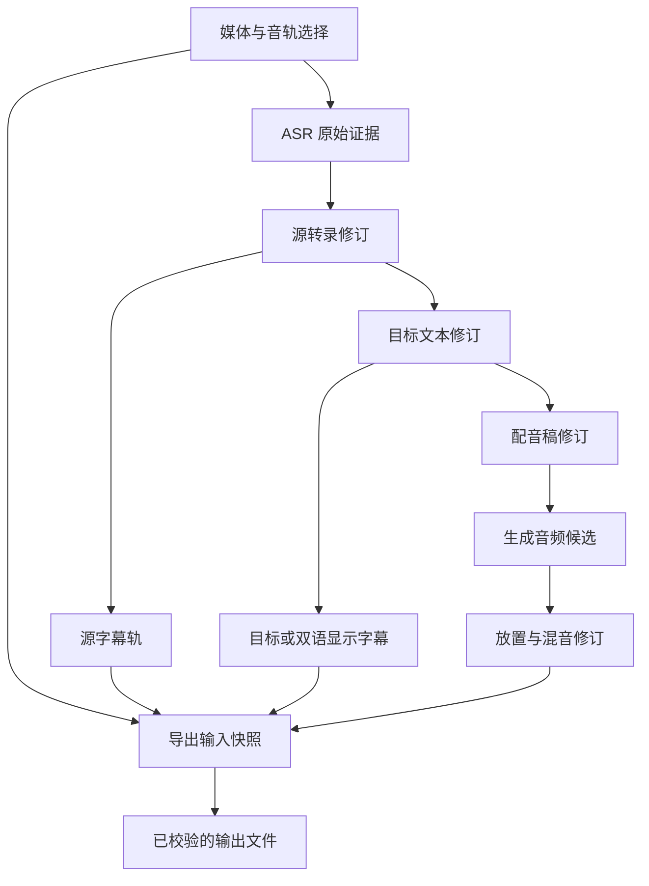

# V2 独立领域与工作流模型

日期：2026-10-03。状态：绿地设计建议，待契约评审；不是已实现 schema。事实依据为本轮用户约束与文末一手资料；下文对象、状态和事务策略均为工程建议。

## 1. 目标与简化原则

用一份项目保存素材引用、原始识别证据、人工工作和可重做的生成结果。V1 数据库、Cue/LanguageLayer/Observation 的结构不构成约束。不需要事件溯源平台、分布式队列、插件商店或可编程工作流引擎。

建议最低结构：项目内稳定实体 ID + 不可变修订 + 当前选用指针 + 按实际输入记录的派生关系。大型媒体/音频是项目文件或外部源引用；轻量元数据和修订保存在本地事务存储。Undo 作用于当前编辑，不能抹去已经运行的任务来源。

## 2. 对象与所有权

| 对象 | 表达什么 | 必须保留的关系 / 最小内容 |
|---|---|---|
| Project | 一份可重新打开的本地化工作 | 项目 ID、格式版本、源素材、选用修订、工作目录状态；不包括云密钥 |
| MediaAsset | 某一版源文件内容 | 稳定 asset ID、当前 locator、内容指纹、时长/streams；路径移动不改变内容身份，内容替换必须重新确认 |
| AudioSelection | 要处理的那条音轨与范围 | asset version、stream、通道选择、源范围；选择原声或旁白不能由模型猜测后静默覆盖 |
| RecognitionRun | 某次本地 ASR 的原始证据 | input selection、runtime/model/revision/backend/parameters、原始 segment/word、完整/部分/失败标记；没有词时间就存缺失 |
| SourceTranscript | 用户持续编辑的源文 | stable span IDs、修订、文字、媒体定位、来源映射；ASR 原始结果永久独立于人工稿 |
| SubtitleTrack | 用于显示的字幕 | language/script/role、cue ID、显示时间、文本映射、样式；分段可与 ASR 和转录不同 |
| TranslationRevision | 某方向的目标文字 | 源修订及上下文范围、target language、unit IDs、目标文本、glossary/prompt/provider provenance、人工锁定状态 |
| DubbingScript | 为朗读调整过的目标文字 | translation/source links、段 ID、口语稿修订、读音指示、目标放置区间；不能静默改写屏幕字幕 |
| VoiceSelection | 所选的许可明确的预设声线 | voice ID、locale、engine/model version、许可状态；不是现实人物身份，也不自动推断为克隆授权 |
| AudioTake | 一次配音合成产生的音频候选 | script revision、voice/settings、实际时长/sample rate、文件摘要、生成状态；可有多次 take，用户选择其中一个 |
| Placement / MixRevision | 音频在原片时间线如何放置 | take、起点、静音/受控变速、原音模式与音量；保存每次 fit 判断，不靠累计拼接猜位置 |
| RenderSnapshot / ExportArtifact | 某次导出的准确输入和产物 | 被选定的字幕/混音修订、字体/编码配置、输出校验/来源；后续编辑不改变旧文件的来源 |
| Task / Attempt | 一次操作与它的执行尝试 | 输入快照、阶段、资源、取消意图、attempt ID、已提交工作单元、错误与输出；重试产生新 attempt |

不是每个名字都需要一个类、表或服务。设计阶段可以合并内部实现；上述独立语义不可通过合表丢掉。

## 3. ID、修订与来源

- ID 标识实体，不使用字幕行号、当前文本或绝对路径作唯一身份。文本变化创建 revision；编辑焦点和列表排序不改变实体身份。
- Split/merge 生成新的 span/cue IDs，保存来源映射；旧实体留在旧修订里，不把旧译文按新行号错配。生成音频不必每条显示字幕一段。
- 工程最小 provenance：输入版本、实际上下文/术语表版本、适配器与模型版本、处理位置、参数、时间、attempt、输出摘要。只保存有用的可重做信息，不默认录制完整网络 payload 或敏感诊断。
- 机器结果是候选。提交时核对输入 revision 和锁状态；用户在运行中改了源文，旧结果可保存为基于旧版的候选，但不能晋升为当前译文/配音。
- 更换模型或发现新版，不自动使已确认文本失效。只有输入内容变化、用户选择重生，或确实发现资源损坏才改变工作状态。
- 使用内容指纹复认同一媒体；大文件完整 hash 的时机可延迟到后台。仅 size/mtime 是快速提示，不能作为替换媒体仍相同的最终证明。

## 4. 失效与人工锁定

这里的“过期”表示派生结果所依据的输入已经变化，仍保留用于比较；不是自动删除，也不是判定文本一定错误。人工锁定表示禁止机器覆盖，不能掩盖过期事实。

| 发生的变化 | 应标记的内容 | 不必自动重做 |
|---|---|---|
| 换源媒体内容、音轨或分析范围 | 对应 ASR 及依赖它的转录/翻译/音频候选需重新核对 | 原项目历史与旧导出保留 |
| 改源文一处 | 直接依赖该处及把它作为上下文的翻译单位、相关配音稿与 take、渲染 | 其它无关区段；ASR 原始证据 |
| 只按阅读需要拆分显示字幕 | 对应字幕布局和渲染；若配音窗口绑定于显示区间则重核放置 | 源文、语义翻译、音频内容 |
| 修改源文而破坏词边界映射 | 相应词级对齐标为待校正，保留段级可编辑定位 | 不把新词伪装成已有精确词时间 |
| 改译文 | 其目标字幕/配音稿的关联需核对，依赖它的音频/渲染 | 源文和 ASR |
| 只改配音稿 | 对应 take 与混音/渲染 | 屏幕字幕不自动同步成另一措辞 |
| 换声线、读音或合成参数 | 对应音频及混音/渲染 | ASR 和译文 |
| 只改放置时间或原音音量 | fit/conflict 与混音/渲染 | TTS 音频内容 |
| 只改字体/颜色/行序 | 字幕布局、预览及需要该轨的渲染 | ASR/翻译/TTS |
| 改术语表 | 实际用过该表的翻译批次需核对，可按记录范围缩小 | 没用该表的其它目标分支 |

依赖校验按真实输入范围，不仅按“同一个 cue”：上下文批次可能跨句，术语表也可能影响全项目。首版可保守标记整批需核对，后续有证据再缩小；不能为了减少重跑而遗漏实际依赖。

锁定译文在源文改动后显示“已锁定，但依据已变”。用户可以保留旧版本并记录已审阅差异、解锁后重生，或人工修改；不能仅把状态改成绿色。导出在存在未解决过期内容时必须让用户看清并确认导出的版本，不静默替换。

## 5. 四种时间与文本坐标

建议内部统一源媒体原点及整数微秒，采样/容器读取边界保留原 timebase 和转换映射。SRT/VTT 最后一步舍入到毫秒，不能让前面各阶段反复舍入积累漂移。

1. **媒体时间**：相对于用户看到的原片起点，含选段 offset、多音轨起点与实际容器 PTS。
2. **证据时间**：ASR/aligner 估计的词/字/段位置；可为空或不可靠。VAD 拼接过的音频必须用分段映射还原，不能按整段时长做单一线性缩放。
3. **显示时间**：字幕为了可读性而调整的时间。双语显示可以共享一个区间，但源文与目标文本仍各有修订和映射。
4. **配音时间**：take 实测长度与原媒体的放置位置。按绝对窗口放置，避免每句相加造成累计偏移。

文本 offset 必须注明所依据的 text revision 与坐标体系，不能混用 Python 字符索引、JavaScript UTF-16 单元或模型 token。建议应用边界用 Unicode code point 范围并在 UI 转换为 grapheme-safe 选择；中文词、法语连字和未来复杂脚本都不能依赖空格计数。

时间有效性与风格约束分开：负数、非有限时间、结束早于开始、超出允许媒体范围是数据错误；相邻字幕重叠、过快阅读等是可解释的复核问题。单旁白配音的音频重叠必须显式处理，不能被字幕允许重叠的规则放行。

## 6. 任务、取消与重试

建议状态：排队 → 等待资源 → 准备 → 运行 → 校验/提交 → 完成。分支为取消请求 → 已取消，以及失败/中断。保留阶段名、可知的处理量、最近进展、重试动作；加载模型或总量未知时显示不确定进度。

Task 是用户的一次意图，Attempt 是实际运行。心跳不等于进度；进程还活着不等于模型已完成。结构化结果协议须包含 task/attempt/input revision，重复或迟到消息不得重复导入。

- 取消优先协作停止，再在超时后终止所属进程树；确认进程停止、输出处理完毕后才显示已取消。Windows Job Objects 可提供进程组管理，具体 spawn/继承/终止逻辑仍需实验。[S3]
- “暂停”只在后端确有安全暂停点时提供。最低承诺是取消及从已提交单元重做，不能把保留模型在 RAM 叫成断点持久化。
- 当前应用退出前说明运行任务将中断/取消并保留已完成工作。首版不承诺关闭 UI 后继续计算，也不引入常驻系统服务；需要后台服务时另开范围。
- 崩溃后把未终结 attempt 判为 Interrupted，校验已有产物，再提供剩余工作重试；不把旧 PID 或未写完文件当成成功。
- 同一阶段只有一个默认 GPU-heavy 任务，阶段切换按需卸载；排队原因可见。以后并行属于经过 RAM/VRAM 验证的优化，不是首版承诺。
- 外部翻译/TTS 取消可能只停止接收和后续工作，供应商仍计费。超时不明结果不能盲目自动重提；记录 provider request ID（可得时）与状态，先查询或让用户确认重试。

## 7. 文件和数据库的一致性

建议由一个应用服务拥有项目写入，workers 只输出暂存产物和消息。SQLite 保证数据库事务，并不把任意音频/视频文件一起变成原子事务。[S1][S2]

建议提交过程：写临时产物 → 关闭并验证可解码/长度/hash → 将完成文件放入受管位置 → 单次 DB 事务记录 artifact 与依赖并更新 attempt → 在 UI 宣告成功。崩溃在 DB 提交前会留下可识别的孤儿文件，恢复时隔离/清理；不能假定两个存储原子联动。最终用户导出可先写同卷临时文件再发布，并拒绝覆盖源素材。

SQLite WAL 若使用，需要 checkpoint/备份策略；不能只拷正在写入的主 DB 忽略 WAL，也不默认支持网络共享盘多端编辑。[S2] 项目关闭或通过受控备份得到一致快照；媒体丢失可重新定位，媒体内容不符必须确认。

更新程序不运行中的 worker 二进制原地替换；任务固定 runtime/model manifest。项目格式升级先备份，新版本写过的数据库不能承诺随应用降级自动兼容。没有 V1 迁移需求，但 V2 自身后续版本仍需格式兼容策略。

## 8. 具体情境检查（推演，未运行原型）

| 情境 | 应有结果 | 决定性的反例 |
|---|---|---|
| 翻译运行中用户改了源句 | 完成结果保存为旧输入候选，当前人工编辑保留 | 迟到结果覆盖新版 |
| 锁定法文译文后改英语源稿 | 法文仍锁定且提示需核对 | 锁定被解释成“永远正确” |
| 三条显示字幕合成一个旁白段 | 一个 take 引用三条的相关源/目标语义，显示换行可独立变更 | 强制每条字幕一次 TTS |
| 英文转中文字幕，改目标字号 | 只重新布局/渲染 | 重跑 ASR 或重新翻译 |
| 中文改错字导致原词时间无映射 | 段级复听仍可用；词时间提示待校正 | 按字符数均分后宣称精确对齐 |
| 新增西班牙语，只有本地字幕路线就绪 | 启用已验证阶段，配音显示未就绪原因 | 三语 enum 导致整产品重设计 |
| TTS 一段失败，前九段成功 | 保留已提交九段，重试失败单元 | 删掉整轨或报整片完成 |
| 源文件搬家后重新定位 | 复认同内容后复用当前工作 | 路径即身份导致全部清空 |
| 渲染中修改译文 | 正在渲染的是固定旧快照，输出清楚标记基于哪版 | 导出混杂新旧版本 |
| 音频文件发布后、DB 提交前断电 | 孤儿产物可恢复核验，任务不能虚报成功 | 单看文件存在就标完成 |

这些情境足以形成 Design 输入；仍需后续小型 E-R2 实验验证具体框架及事务恢复，不需要本轮建立生产 schema 或视觉原型。

## 来源与推断边界

- [S1 SQLite Atomic Commit](https://www.sqlite.org/atomiccommit.html)：本地事务原子性及底层假设；不证明外部媒体文件原子提交。
- [S2 SQLite WAL](https://www.sqlite.org/wal.html)：WAL、writer、备份/同机约束。应用单写入者是本稿为简化一致性提出的架构选择。
- [S3 Windows Job Objects](https://learn.microsoft.com/en-us/windows/win32/procthread/job-objects)：组管理/终止机制；不是自动成功的跨框架 worker supervisor。
- [S4 RFC 5646](https://www.rfc-editor.org/rfc/rfc5646)：语言标签基础；具体阶段能力另见语言策略。
- Round 1 的 MD 缺词级持久化与 V1 共享语言时间结构仅作问题证据，详见 [MD 调查](../v2_discovery/02_MEDIA_DOWNLOADER_ASR.md)、[V1 调查](../v2_discovery/05_V1_REUSE_REWORK_RETIRE.md)，不继承其设计约束。

来源访问日期：2026-10-03。本文无已运行恢复测试、数据库原型或真实媒体质量结果。
